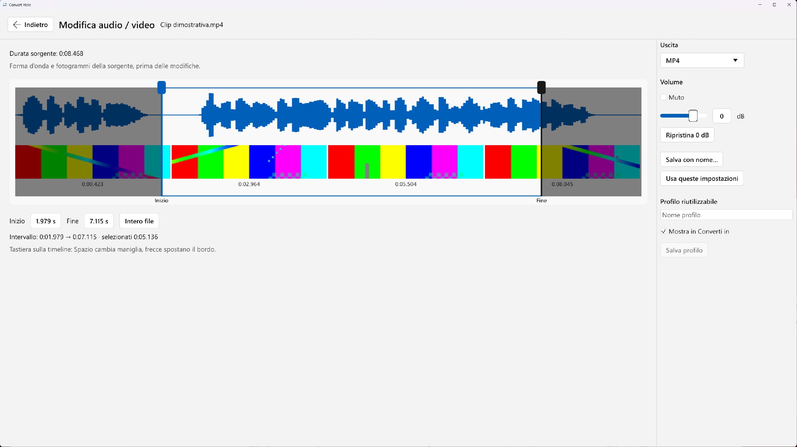

# Convert Here

[Italiano](README.md) · **English**

**Convert audio, video, images and documents directly on your Windows PC.**

Developed by **[Salvatore Corsi](https://github.com/salvatorecorsi)**, Convert Here is a free, open source program written in Rust. Use its window, the File Explorer context menu or the command line. Conversion and OCR run on your computer without uploading your files to an online service. No account, subscription, in-app purchases or usage-based charges. No payment is required to keep using it.

[Download for Windows](https://github.com/salvatorecorsi/convert-here/releases/latest) · [Microsoft Store](https://apps.microsoft.com/detail/9NPKPPCBNBM8) · [What's new in 0.8.0](docs/release-notes-0.8.0.en.md) · [Report a problem](https://github.com/salvatorecorsi/convert-here/issues)

**Convert Here is bilingual, in Italian and English.** Download the installer or portable package and choose a language in **Settings → Language**. See [Languages](#languages).

**0.8.0 is published on GitHub** as of **10 November 2026, 12:09:39 UTC**, from clean commit `f1f3f95fceed52507ef715fa4ac6893acc63544a`. [English notes](docs/release-notes-0.8.0.en.md) / [Italian](docs/release-notes-0.8.0.md). The **Store 1.0.8.0 update has been submitted and is in certification**, with automatic publication after approval. Preceding **1.0.7.0 is published in the Store**; new 1.0.8.0 is not yet declared approved or available. [Store status](docs/store-submission.md).

**New in 0.8.0:** native SVG input, an audio/video timeline editor, local audio/video-to-TXT transcription, and in-app downloads for Tesseract, libheif and Whisper + Tiny. Package/source audits, offline checks and [Windows checks](https://github.com/salvatorecorsi/convert-here/actions/runs/42811925135) passed. WACK and testing the newly installed MSIX on a physical Windows 10 host are not attested.

The [historical captures of preceding version 0.7.1](docs/store-assets/0.7.1/README.md) remain separate from the new 0.8.0 screenshots.



*Native 0.8.0 build, 2562 × 1441, 150% UI zoom, without the pointer. [New capture provenance](docs/store-assets/0.8.0/README.md).*

## What you can do

- **Convert multiple files together**, with 44 output formats and 94 recognized input extensions including SVG.
- **Use the right-click menu** to queue quick conversions with your saved preferences or open custom settings.
- **Convert audio and video**, extract audio from video, create animated GIFs and adjust quality, dimensions and time range.
- **Trim audio/video on a timeline** and adjust gain/mute; transcribe speech to TXT with local Whisper.
- **Convert and resize images**, create PDFs from images and work with HEIC/HEIF, AVIF, OpenEXR and HDR.
- **Compress, split and merge PDFs**, including arranging individual pages from different images and documents.
- **Extract text from images to TXT and from PDFs to TXT, Word DOCX or HTML**, with local OCR for scans.
- **Convert Office documents, Excel, CSV and HTML**, including choosing the CSV separator.
- **Customize visible formats and appearance**, with system, light and dark themes.

## Editor and profiles

Open **Edit…** beside an image to crop, resize and create a canvas with a custom background, resolution and position. Export PNG, JPEG, WebP or PDF with a preview and actual byte size: saving writes the same prepared bytes without overwriting existing files. JPEG/WebP offer adjustable quality and a size limit; **300 kB = 300000 bytes**. Further dimension reduction is optional; an impossible limit prevents saving.

Lay out images, text written in **New sheet…** or UTF-8 TXT on **A4/A5** without external engines. In **Profiles**, create, edit, duplicate, rename or delete up to **32 recipes**, with **8 in Convert to**. Choose each profile's allowed inputs, output folder and default status; import and export JSON recipes without including sample images or text. **PDF Merge** profiles open page ordering with their saved settings and require at least two files. [Editor and profiles guide](docs/image-editor-profiles.en.md).

## Installation

The GitHub distribution requires **Windows 10 build 19041 or later, x64**. The [0.8.0 release](https://github.com/salvatorecorsi/convert-here/releases/tag/v0.8.0) offers:

| Package | How to use it |
| --- | --- |
| [ConvertHere-0.8.0-windows-x64-setup.exe](https://github.com/salvatorecorsi/convert-here/releases/download/v0.8.0/ConvertHere-0.8.0-windows-x64-setup.exe) | Run the setup. It installs for your user without administrator privileges; optional context-menu integration is selected by default. |
| [ConvertHere-0.8.0-windows-x64-portable.zip](https://github.com/salvatorecorsi/convert-here/releases/download/v0.8.0/ConvertHere-0.8.0-windows-x64-portable.zip) | Extract it to a stable folder and run `the-converter.exe`. It also includes the CLI and context-menu scripts. |

Check the packages against `SHA256SUMS.txt` from the same release. The executable names remain `the-converter.exe` and `the-converter-cli.exe`; some earlier releases display the name The Converter.

**Native images, images to PDF and operations on existing PDFs work immediately.** Configure the [optional engines](#optional-engines) for other conversions: the setup neither includes nor downloads them. Python, Node and Rust are not required to run the app.

In the GitHub distribution, the Windows 11 menu is under **Show more options**. The GitHub distribution does not include Authenticode signing. See the [Windows integration guide](docs/windows-integration.en.md) for classic and modern menu details.

To uninstall, use **Windows Settings → Apps → Installed apps → Convert Here → Uninstall**. Preferences and converted files are preserved.

## How to use it

### From the app window

1. In **Files**, drag files into the window or choose **Add files**.
2. Select the output **format** and a preset: **Compact**, **Balanced** or **High quality**.
3. Choose to save **next to the original** or in a folder of your choice. Open **Custom settings** for format-specific controls.
4. Start the conversion and follow each file's progress. You can cancel the job.

Preferences are saved between sessions. Originals and existing results are preserved: the app adds a number when a name is already taken. The interactive queue uses one format shared by the selection; convert categories in separate groups if they have no common destination.

The sections separate tasks: **Files** prepares conversions, **History** shows active jobs and previous results, and **Profiles** manages recipes on the left; **Settings** configures engines, outputs and appearance on the right. History also retains results from the main window, editors and PDF Merge between sessions.

### From the File Explorer context menu

Select one or more files and choose **Convert to → MP3**, **WAV**, **PDF** or another compatible format. The conversion enters the background quick queue using your saved settings. **Custom settings…** opens the app window instead.

A placeholder with a **blue hourglass** and the planned output name appears in the destination. It is a temporary shortcut: double-click to see progress, details and cancellation. The converted file replaces it when the job finishes; an error gives it a **red X**. Closing the status window lets the job continue. **History** combines quick-queue jobs and window conversions. [How the queue works](docs/queued-conversions.en.md).

With multiple files that can become PDFs:

- **PDF (Bulk)** creates separate results, one per source. Existing PDFs are compressed without loss.
- **PDF (Merge)** opens the page editor to create a single document in your chosen order.

### Choosing which formats to show

Open **Settings → Output formats** and enable the destinations you use. Your choices apply to both the app selector and File Explorer, without restarting Explorer. **MP3, WAV, JPG, PNG, WebP, GIF, PDF and MP4** are enabled initially. Each selection shows only compatible destinations.

Enable every format, restore the common formats or choose individual outputs. This is a display filter: all inputs remain recognized and the CLI keeps every destination. The Language section lets you choose System, Italiano or English.

## Formats and conversions

| File type | Available conversions | Required engine |
| --- | --- | --- |
| Audio | MP3, WAV, FLAC, AAC, OGG, Opus, AIFF, M4A, WMA, AC3, AU, CAF | FFmpeg |
| Video | MP4, MKV, MOV, WebM, AVI, animated GIF, MPEG, WMV, FLV, TS, M4V, 3GP; audio extraction to the formats above | FFmpeg |
| Images | PNG, JPEG, WebP, BMP, TIFF, GIF, ICO, QOI, TGA, Farbfeld, OpenEXR, HDR, PNM; PDF; HEIC and AVIF; TXT with OCR | None for native images and PDF; libheif for HEIC/AVIF; Tesseract for TXT |
| PDF | PNG/JPEG per page; TXT, DOCX and HTML from text; compression, splitting and merging | Poppler for images and text; Tesseract + Poppler for OCR; none for compression, splitting and merging of existing PDFs |
| DOC/DOCX, ODT, RTF, TXT, PPT/PPTX, ODP | PDF | LibreOffice |
| XLS/XLSX/XLSM, ODS, CSV | CSV, Excel XLSX, PDF | LibreOffice |
| HTML/HTM | PDF | LibreOffice |

0.8.0 accepts **SVG** as image/PDF input, rasterized locally with resvg without external engines. It accepts self-contained static UTF-8 SVG; SVGZ, external resources and embedded raster images are unsupported. SVG is not a new output format.

Adjust audio bitrate, sample rate, channels and normalization; video H.264/H.265 codec, quality, width, FPS and trimming; image resizing, JPEG quality and PDF DPI. The app shows the relevant controls for each format. Available audio/video codecs depend on the configured FFmpeg build.

The [complete conversion guide](docs/conversions.en.md) lists input extensions, codecs, options and the limits of each family.

### Limits and advanced options

Profiles can set a **maximum size for each output** and a **maximum audio/video duration**. Size is checked against the produced bytes; oversized outputs are not published. The JPEG/WebP editor can adapt quality and, with permission, dimensions. An audio/video size limit does not promise automatic quality or bitrate adjustment. Duration applies after the trim start and also respects any selected end time.

For audio, video and video-to-GIF, **Advanced** provides searchable codec, filter, metadata and performance controls. Encoder-specific options are read from the configured local FFmpeg and checked before conversion. Choices depend on the codec, container and installed engines; this is not a free-form command field. Profiles with these options require audio/video sources. Native image-to-GIF remains available without FFmpeg options. [Configuration and profiles](docs/configuration.en.md#personal-profiles).

### Compressing, splitting and merging PDFs

For a PDF, select **PDF** and the desired operation in its options:

- **Lossless compression** creates `name-compresso.pdf` without resampling images. If rewriting would produce a larger file, the app keeps a copy of the original bytes: the result may be the same size as the source.
- **Split: one page per file** creates `name-pagina-001.pdf`, `name-pagina-002.pdf` and so on.
- **PDF (Merge) · arrange pages** prepares the sources and opens the editor. Move pages using the handle, arrows or **Alt+↑ / Alt+↓**, then choose **Create merged PDF**.

Pages from multipage PDFs, images and Office documents can be interleaved. Every row identifies the source file and original page number. [Historical PDF Merge capture](https://github.com/salvatorecorsi/convert-here/blob/v0.7.0/docs/screenshots/en-merge-pdf.jpg).

The merged result is named after the first source with the `-unito.pdf` suffix, with a number added if needed. Every page is included once, up to 10,000 pages; check the order in the editor. The originals are unchanged and intermediate PDFs are prepared in a temporary user folder. Output suffixes remain the same in both interface languages.

These operations on existing PDFs and merging native images work without external engines. Office/CSV/HTML sources require LibreOffice; HEIC/AVIF require libheif. Encrypted or signed PDFs are rejected; merging and splitting also reject interactive forms and do not transfer document bookmarks, tags or metadata.

### Extracting text and using OCR

For an image, choose **TXT · Local OCR**. For a PDF, choose **TXT**, **Word DOCX** or **HTML**: embedded text is normally extracted; enable **Recognize scanned pages with local OCR** for a scanned document.

OCR uses **Tesseract** with installed language models; PDFs also require **Poppler**. The default recognition language is **Italian + English** (`ita+eng`), but you can select other languages or enter your models' codes. For scanned PDFs, 300 DPI is a useful starting point.

Recognized text stays on your PC. Review it for errors: OCR does not recreate the layout or add a searchable layer to the original PDF. PDF-to-DOCX/HTML exports reconstruct text and page separation without original images, tables or formatting.

### Audio/video timeline and transcription

**Edit…** beside an audio or video opens a single track with a source waveform and frame strip. Drag the start/end handles or use numeric times and the keyboard; adjust gain from **−60 to +20 dB** or mute. **Save as…** converts only that file to a new destination; **Use these settings** returns trimming and options to the active settings. You can save the recipe as a profile. Previews show the source before effects; the editor has no playback or multitrack editing.

To transcribe, enable **TXT** in **Settings → Output formats → Raw**, then select TXT for audio/video. It requires **FFmpeg and Whisper + Tiny multilingual**, downloaded on request; no account, API key or cloud service is needed. TXT mode in the editor applies only trimming and recognition settings, without gain or encoder options. Language defaults to automatic detection; choose Italian, English or another supported Whisper code and configure threads. Profiles retain these parameters without the recording or transcript content.

Recognition runs locally on the CPU using temporary WAV/TXT chunks of at most ten minutes. Text may need correction; the video's visual content is not reconstructed. **Whisper + Tiny** downloads about **88 MB**, including **77,691,713 bytes** for the model. If FFmpeg or ffprobe is missing, the app's installation button adds FFmpeg to the request; its download is separate.

### Excel, CSV, HEIC and AVIF

With LibreOffice, convert spreadsheets to XLSX, CSV or PDF. For CSV, choose **comma, semicolon, tab or pipe**: the same separator is used for import and export. CSV is UTF-8; export keeps the displayed values of the **first sheet**, without formulas, formatting or other sheets. Import keeps quoted fields as text and does not evaluate formulas.

Configure `heif-dec.exe` to read HEIC/HEIF and AVIF; configure `heif-enc.exe` to create them. Both belong to libheif and must be kept with compatible DLLs and plugins. Width and quality are adjustable.

GIF, TIFF and image containers with multiple frames or pages are read from the first image. Video-to-GIF conversion preserves animation. Ordinary WebP conversion is lossless; the 0.6.0 editor adds adjustable WebP quality. JPEG quality does not affect lossless formats. [All format details and limitations](docs/conversions.en.md).

## Optional engines

Open **Settings → Conversion engines** to detect installed tools or choose their paths.

| Engine | Purpose | Configuration |
| --- | --- | --- |
| **FFmpeg** | Audio, video, audio extraction and GIFs from video | Download in the app or select `ffmpeg.exe` |
| **Poppler** | PDF images, embedded text and page preparation for OCR | Download in the app or select `pdftoppm.exe`, `pdftotext.exe` and `pdfinfo.exe` |
| **LibreOffice** | Office documents, Excel/CSV and HTML | Local installation and `soffice.exe` path |
| **Tesseract** | OCR | Download with Italian/English; existing `tesseract.exe` and language models remain selectable |
| **libheif** | Reading and creating HEIC/HEIF and AVIF | Portable download; existing `heif-dec.exe` and `heif-enc.exe` with DLLs/plugins remain selectable |
| **Whisper + Tiny** | Audio/video → TXT | Download the CPU runtime and multilingual model; FFmpeg required |

**Download FFmpeg and Poppler directly from the app**, including the portable edition. Before confirmation, you see the source, version, size, licenses and installation folder. In 0.8.0, both archives require about **159 MB of downloads** and about **615 MB of free space** during download and extraction. SHA-256 checksums are verified and licenses and documentation are retained.

Downloading starts only after confirmation. Engines use your user folder; files to convert stay on your PC. [Historical confirmation dialog](https://github.com/salvatorecorsi/convert-here/blob/v0.7.0/docs/screenshots/en-download-engines.jpg).

0.8.0 adds portable **Tesseract 5.5.4** with `ita`/`eng`, **libheif 1.23.7**, and **Whisper + Tiny**, retaining MSYS2 UCRT64 dependencies and licenses. These are optional downloads into your personal folder, not system installers; LibreOffice remains separately configured. See the [configuration guide](docs/configuration.en.md) for paths, sources, preferences and queue recovery.

## Languages

The app and File Explorer menu support **Italian and English** from version 0.5.0. In **Settings → Language**, choose **System**, **Italiano** or **English**. System follows the Windows display language: Italian is used for Italian Windows, English for other languages. The choice is saved separately from OCR settings.

The installer supports Italian and English. The CLI uses stable English option names; `--language system|it|en` selects the language for that invocation without changing saved preferences. Messages from Windows and external engines may follow their own language settings.

The installer and portable packages in [GitHub release 0.8.0](https://github.com/salvatorecorsi/convert-here/releases/tag/v0.8.0) include the bilingual interface ready to use.

**OCR supports the languages of the installed Tesseract models**: Italian and English are the default; the app also offers French, German, Spanish and a field for other codes. Recognition language is independent of interface language.

## Data and privacy

Conversion, OCR and transcription run locally. Preferences, queue records and reports are stored on the device and may contain paths and errors. There is no telemetry, advertising or app account registration. Optional downloads contact engine/model providers without uploading the content to process.

Optional engine downloads require Internet access and contact the distributors; opening HTML may load linked images or CSS, including remote resources, through LibreOffice. The app preserves originals and does not send files to a developer server. [Privacy statement (Italian and English)](docs/privacy.md).

## Command line

The GitHub distribution includes `the-converter-cli.exe`. For example, from its folder:

```powershell
.\the-converter-cli.exe --language en --diagnose
.\the-converter-cli.exe --language en --convert --target mp3 --preset quality --files "C:\Video\clip.mp4"
.\the-converter-cli.exe --language en --convert --target docx --ocr --ocr-language ita+eng --files "C:\Documents\scan.pdf"
.\the-converter-cli.exe --language en --convert --target pdf --pdf-action merge --files "C:\Documents\first.pdf" "C:\Documents\second.pdf"
```

The CLI continues with other files after an error and exits with a nonzero code if any conversion fails. **Ctrl+C** cancels the process. [Complete CLI guide, options and JSON examples](docs/command-line.en.md).

## Development and documentation

Building requires Windows x64, Rust stable MSVC and Visual Studio C++ Build Tools with the Windows SDK:

```powershell
cargo build --release --locked
cargo build --release --locked --manifest-path .\shell-extension\Cargo.toml
```

The [developer guide](docs/development.en.md) describes tests, distribution builds, the installer and the source archive with dependencies for offline builds.

- [Conversions, options and limitations](docs/conversions.en.md)
- [Configuration, engines and local data](docs/configuration.en.md)
- [Quick queue and placeholders](docs/queued-conversions.en.md)
- [File Explorer integration](docs/windows-integration.en.md)
- [Screenshot sources and versions (Italian)](docs/screenshots/README.md)

## Author and license

**Salvatore Corsi** · [GitHub profile](https://github.com/salvatorecorsi) · [Support](mailto:salvo@salvatorecorsi.com)

Copyright (C) 2026 Salvatore Corsi. The original code is licensed under **GNU GPL version 3 only** (`GPL-3.0-only`), without warranty under the terms of the [complete license](LICENSE). The project continues the work of [Final Converter](https://github.com/salvatorecorsi/final-converter).

Sources are public; the release includes [ConvertHere-0.8.0-source.zip](https://github.com/salvatorecorsi/convert-here/releases/download/v0.8.0/ConvertHere-0.8.0-source.zip) with both lockfiles, **465 vendored crates** and offline build instructions. Offline checks for the app and DLL passed with an initially empty cache; they do not attest a full linked build. Conversion does not change the rights to your content or impose the GPL on results solely through use of the program. Dependencies, fonts and engines retain their own licenses: [third-party notices](THIRD-PARTY-NOTICES.md) and [license texts](docs/release-licenses/README.md).
