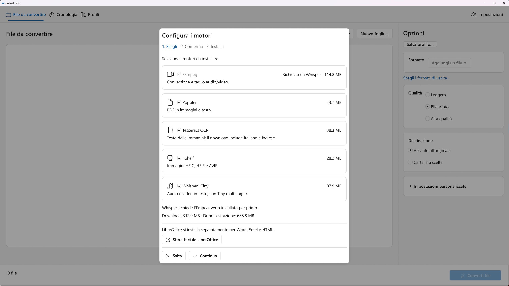
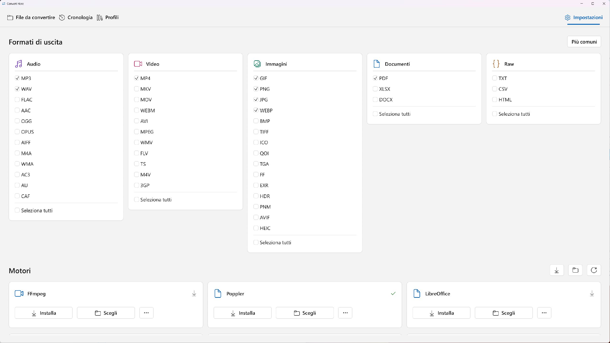

# Convert Here

[**Italiano**](README.md) · [English](README.en.md)

**Converti audio, video, immagini e documenti direttamente dal tuo PC Windows.**

Sviluppato da **[Salvatore Corsi](https://github.com/salvatorecorsi)**, Convert Here è un programma gratuito e open source scritto in Rust. Puoi usarlo dalla sua finestra, dal menu di Esplora file o dalla riga di comando. Le conversioni e l'OCR avvengono sul computer, senza caricare i tuoi file su un servizio online. Nessun account, abbonamento, acquisto in-app o costo a consumo. Nessun pagamento richiesto per continuare a usarlo.

[Scarica per Windows](https://github.com/salvatorecorsi/convert-here/releases/latest) · [Microsoft Store](https://apps.microsoft.com/detail/9NPKPPCBNBM8) · [Novità della 0.8.1](docs/release-notes-0.8.1.md) · [Segnala un problema](https://github.com/salvatorecorsi/convert-here/issues)

**Convert Here è bilingue, in italiano e inglese.** Scarica installer o portable e scegli la lingua in **Impostazioni → Lingua**. Vedi [Lingue](#lingue).

La **0.8.1 è pubblicata su GitHub** dal **10 novembre 2026, 14:42:06 CET (13:42:06 UTC)**, dal commit pulito `07fe5f749327b73e93a92d5101d80b9b4f5317cb`. [Note IT](docs/release-notes-0.8.1.md) / [EN](docs/release-notes-0.8.1.en.md). **Store 1.0.9.0 è in certificazione**, Submission 6, con pubblicazione automatica appena approvato. La precedente **1.0.8.0 è pubblicata nello Store**; la nuova 1.0.9.0 non è ancora dichiarata approvata o disponibile. [Stato Store](docs/store-submission.md).

**Novità della 0.8.1:** configurazione guidata dei motori al primo avvio e **Seleziona tutti** in fondo a ogni categoria. Scegli i motori, controlla fonti, dimensioni e licenze, poi scaricali uno alla volta. **442 test**, **13 conversioni CLI**, audit dei pacchetti e dei sorgenti e controlli offline passati, insieme ai [Windows checks](https://github.com/salvatorecorsi/convert-here/actions/runs/42825704990). WACK e prova su host Windows 10 reale non sono attestati.

La [galleria 0.8.1](docs/store-assets/0.8.1/README.md) comprende due nuove catture di wizard e formati e due catture storiche 0.8.0 degli editor, riusate con interfaccia invariata. Ogni immagine conserva la propria provenienza.





*Catture native della build debug 0.8.1, 2562 × 1441, zoom 150%, senza puntatore. [Provenienza delle schermate](docs/store-assets/0.8.1/README.md).*

## Cosa puoi fare

- **Convertire più file insieme**, con 44 formati di destinazione e 94 estensioni di ingresso riconosciute, compresa SVG.
- **Usare il tasto destro** per accodare conversioni rapide con le preferenze salvate, oppure aprire le impostazioni personalizzate.
- **Convertire audio e video**, estrarre l'audio da un video, creare GIF animate, regolare qualità, dimensioni e intervallo temporale.
- **Tagliare audio/video da una timeline** e regolare gain/muto; trascrivere il parlato in TXT con Whisper locale.
- **Convertire e ridimensionare immagini**, creare PDF da immagini e lavorare anche con HEIC/HEIF, AVIF, OpenEXR e HDR.
- **Comprimere, dividere e unire PDF**, ordinando anche le singole pagine di immagini e documenti diversi.
- **Estrarre testo dalle immagini in TXT e dai PDF in TXT, Word DOCX o HTML**, con OCR locale per le scansioni.
- **Convertire documenti Office, Excel, CSV e HTML**, scegliendo anche il separatore dei CSV.
- **Personalizzare i formati visibili e l'aspetto**, con tema di sistema, chiaro o scuro.

## Editor e profili

Apri **Modifica…** dalla riga di un'immagine per ritagliare, ridimensionare e creare una tela con sfondo, risoluzione e posizione scelti. Esporta PNG, JPEG, WebP o PDF con anteprima e peso effettivo: il salvataggio scrive gli stessi byte preparati, senza sovrascrivere file esistenti. JPEG/WebP hanno qualità regolabile e un peso massimo; **300 kB = 300000 byte**. La riduzione ulteriore delle dimensioni è facoltativa; un limite impossibile impedisce il salvataggio.

Impagina immagini, testo scritto in **Nuovo foglio…** o TXT UTF-8 su **A4/A5**, senza motori esterni. Nella scheda **Profili** crea, modifica, duplica, rinomina o elimina fino a **32 ricette**, di cui **8 nel menu Converti in**. Scegli gli ingressi ammessi per ogni profilo, la cartella di uscita e il predefinito; importa ed esporta ricette JSON senza includere immagini o testo di prova. I profili **PDF Merge** aprono l'ordinamento delle pagine con le opzioni salvate e richiedono almeno due file. [Guida editor e profili](docs/image-editor-profiles.md).

## Installazione

La distribuzione GitHub richiede **Windows 10 build 19041 o successivo, x64**. Dalla [release 0.8.1](https://github.com/salvatorecorsi/convert-here/releases/tag/v0.8.1) puoi scegliere:

| Pacchetto | Come si usa |
| --- | --- |
| [ConvertHere-0.8.1-windows-x64-setup.exe](https://github.com/salvatorecorsi/convert-here/releases/download/v0.8.1/ConvertHere-0.8.1-windows-x64-setup.exe) | Avvia il setup. Installa per il tuo utente, senza privilegi amministrativi; l'integrazione con il menu contestuale è facoltativa e selezionata per default. |
| [ConvertHere-0.8.1-windows-x64-portable.zip](https://github.com/salvatorecorsi/convert-here/releases/download/v0.8.1/ConvertHere-0.8.1-windows-x64-portable.zip) | Estrai in una cartella stabile e avvia `the-converter.exe`. Include anche la CLI e gli script per il menu contestuale. |

Puoi verificare i pacchetti con `SHA256SUMS.txt` nella stessa release. I nomi tecnici degli eseguibili restano `the-converter.exe` e `the-converter-cli.exe`; alcune release precedenti mostrano il nome The Converter.

**Immagini native, immagini in PDF e operazioni sui PDF esistenti funzionano subito.** Per le altre conversioni configura i [motori opzionali](#motori-opzionali): il setup non li include e non li scarica. L'app non richiede Python, Node o Rust per essere eseguita.

Al primo avvio normale della finestra principale compare la **configurazione guidata dei motori**. I motori mancanti sono preselezionati; controlla la scelta e conferma il download. I motori vengono installati **uno alla volta**. **Salta** prosegue senza installare; puoi riaprire la procedura da **Impostazioni → Motori → Configurazione guidata**. LibreOffice resta un’installazione separata.

Nella distribuzione GitHub il menu di Windows 11 si trova in **Mostra altre opzioni**. La distribuzione GitHub non prevede firma Authenticode. Per i dettagli sul menu classico e moderno consulta la [guida all'integrazione con Windows](docs/windows-integration.md).

Per disinstallare usa **Impostazioni Windows → App → App installate → Convert Here → Disinstalla**. Preferenze e file convertiti restano conservati.

## Come si usa

### Dalla finestra dell'app

1. Nella scheda **File**, trascina i file nella finestra oppure scegli **Aggiungi file**.
2. Seleziona il **formato** di destinazione e un preset: **Leggero**, **Bilanciato** o **Alta qualità**.
3. Scegli se salvare **accanto all'originale** o in una cartella a tua scelta. Apri **Impostazioni personalizzate** per i controlli del formato.
4. Avvia la conversione e segui l'avanzamento dei singoli file. Puoi annullare il lavoro.

Le preferenze restano salvate tra gli avvii. Gli originali e i risultati già presenti vengono conservati: se un nome è occupato, l'app aggiunge un numero. La coda interattiva usa un formato comune alla selezione; se le categorie non hanno una destinazione comune, convertile in gruppi separati.

Le sezioni separano le attività: **File** per preparare le conversioni, **Cronologia** per lavori attivi e risultati precedenti, **Profili** per gestire le ricette, a sinistra; **Impostazioni** per motori, uscite e aspetto, a destra. La cronologia conserva anche i risultati della finestra principale, degli editor e di PDF Merge tra gli avvii.

### Dal tasto destro in Esplora file

Seleziona uno o più file e scegli **Converti in → MP3**, **WAV**, **PDF** o un altro formato compatibile. La conversione entra nella coda rapida in background con le impostazioni salvate. **Impostazioni personalizzate…** apre invece la finestra dell'app.

Nella destinazione compare un segnaposto con una **clessidra blu** e il nome previsto del risultato. È un collegamento temporaneo: fai doppio clic per vedere avanzamento, dettagli e annullamento. Al termine viene sostituito dal file convertito; in caso di errore mostra una **X rossa**. Chiudere la finestra di stato lascia proseguire il lavoro. La scheda **Cronologia** riunisce coda rapida e conversioni della finestra. [Come funziona la coda](docs/queued-conversions.md).

Con più file convertibili in PDF:

- **PDF (Bulk)** crea risultati separati, uno per sorgente. Su PDF già esistenti applica la compressione senza perdita.
- **PDF (Merge)** apre l'editor delle pagine per creare un unico documento nell'ordine scelto.

### Scegliere i formati da mostrare

Apri **Impostazioni → Formati di uscita** e abilita le destinazioni che usi. Le scelte valgono sia nel selettore dell'app sia nel menu di Esplora file, senza riavviare Explorer. All'inizio sono attivi **MP3, WAV, JPG, PNG, WebP, GIF, PDF e MP4**. Ogni selezione mostra soltanto le destinazioni compatibili.

Usa **Seleziona tutti** in fondo a una categoria per attivarla o disattivarla. Le singole estensioni restano cliccabili: togliendone una, si deseleziona anche **Seleziona tutti**. **Più comuni** ripristina le otto uscite iniziali. Il filtro riguarda la visualizzazione: tutti gli ingressi restano riconosciuti e la CLI mantiene tutte le destinazioni.

## Formati e conversioni

| Tipo di file | Conversioni disponibili | Motore richiesto |
| --- | --- | --- |
| Audio | MP3, WAV, FLAC, AAC, OGG, Opus, AIFF, M4A, WMA, AC3, AU, CAF | FFmpeg |
| Video | MP4, MKV, MOV, WebM, AVI, GIF animato, MPEG, WMV, FLV, TS, M4V, 3GP; estrazione audio nei formati sopra | FFmpeg |
| Immagini | PNG, JPEG, WebP, BMP, TIFF, GIF, ICO, QOI, TGA, Farbfeld, OpenEXR, HDR, PNM; PDF; HEIC e AVIF; TXT con OCR | Nessuno per immagini native e PDF; libheif per HEIC/AVIF; Tesseract per TXT |
| PDF | PNG/JPEG per pagina; TXT, DOCX e HTML dal testo; compressione, divisione e unione | Poppler per immagini e testo; Tesseract + Poppler per OCR; nessuno per compressione, divisione e unione di PDF esistenti |
| DOC/DOCX, ODT, RTF, TXT, PPT/PPTX, ODP | PDF | LibreOffice |
| XLS/XLSX/XLSM, ODS, CSV | CSV, Excel XLSX, PDF | LibreOffice |
| HTML/HTM | PDF | LibreOffice |

**SVG** è un ingresso per immagini e PDF: viene rasterizzato localmente con resvg, senza motori esterni. Sono accettati SVG statici UTF-8 autosufficienti; SVGZ, risorse esterne e immagini raster incorporate non sono supportati. SVG non è una destinazione di uscita.

Puoi regolare bitrate, frequenza, canali e normalizzazione audio; codec H.264/H.265, qualità, larghezza, FPS e taglio dei video; ridimensionamento, qualità JPEG e DPI dei PDF. L'app mostra i controlli pertinenti al formato. La disponibilità dei codec audio/video dipende dalla build di FFmpeg configurata.

La [guida completa alle conversioni](docs/conversions.md) elenca estensioni di ingresso, codec, opzioni e limiti di ogni famiglia.

### Limiti e opzioni avanzate

Nei profili puoi impostare un **peso massimo per ogni risultato** e una **durata massima audio/video**. Il peso è verificato sui byte prodotti: se supera il limite, il risultato non viene pubblicato. L'editor JPEG/WebP può adattare la qualità e, se autorizzato, le dimensioni; per audio e video un limite di peso non promette una qualità o un bitrate adattati automaticamente. La durata si applica dopo l'inizio del taglio e rispetta anche l'eventuale fine scelta.

Per audio, video e GIF da video, **Avanzate** offre una ricerca tra controlli di codec, filtri, metadati e prestazioni. Le opzioni specifiche dell'encoder vengono lette dal FFmpeg locale configurato e verificate prima della conversione. Le scelte dipendono da codec, contenitore e motori installati: non è un campo per comandi liberi. Un profilo con queste opzioni accetta sorgenti audio/video; la conversione nativa immagine → GIF resta disponibile senza opzioni FFmpeg. [Configurazione e profili](docs/configuration.md#profili-personali).

### Comprimere, dividere e unire PDF

Per un PDF scegli **PDF** e l'operazione desiderata nelle opzioni:

- **Compressione senza perdita**: crea `nome-compresso.pdf` senza ricampionare le immagini. Se la riscrittura sarebbe più grande, conserva una copia dei byte originali: il risultato può avere le stesse dimensioni della sorgente.
- **Dividi: una pagina per file**: crea `nome-pagina-001.pdf`, `nome-pagina-002.pdf` e così via.
- **PDF (Merge) · ordina pagine**: prepara le sorgenti e apre l'editor. Sposta le pagine con la maniglia, le frecce o **Alt+↑ / Alt+↓**, poi scegli **Crea PDF unico**.

Puoi intercalare le pagine di PDF multipagina, immagini e documenti Office. Ogni riga indica il file e il numero di pagina originale. [Cattura storica di PDF Merge](https://github.com/salvatorecorsi/convert-here/blob/v0.7.0/docs/screenshots/unione-pdf.png).

Il risultato dell'unione si chiama `primo-unito.pdf`, con un numero aggiunto se il nome esiste già. Sono incluse tutte le pagine una volta, fino a 10.000; controlla l'ordine nell'editor. Gli originali restano invariati e i PDF intermedi vengono preparati in una cartella temporanea dell'utente.

Queste operazioni su PDF esistenti e l'unione di immagini native funzionano senza motori esterni. Le sorgenti Office/CSV/HTML richiedono LibreOffice, HEIC/AVIF richiedono libheif. I PDF cifrati o firmati sono rifiutati; unione e divisione rifiutano anche i moduli interattivi e non trasferiscono segnalibri, tag e metadati del documento.

### Estrarre testo e usare l'OCR

Per un'immagine scegli **TXT · OCR locale**. Per un PDF scegli **TXT**, **Word DOCX** o **HTML**: normalmente viene estratto il testo incorporato; se il documento è una scansione, abilita **OCR locale**.

L'OCR usa **Tesseract** con i modelli installati; sui PDF richiede anche **Poppler**. La lingua predefinita è **italiano + inglese** (`ita+eng`), ma puoi selezionare altre lingue o inserire i codici dei tuoi modelli. Per le scansioni PDF, 300 DPI è un punto di partenza utile.

Il testo riconosciuto resta sul PC. Rileggilo per correggere eventuali errori: l'OCR non ricrea l'impaginazione e non aggiunge uno strato ricercabile al PDF originale. Le esportazioni PDF in DOCX/HTML ricostruiscono il testo e la separazione delle pagine, senza immagini, tabelle o formattazione originale.

### Timeline audio/video e trascrizione

**Modifica…** accanto a un audio o video apre una traccia singola con forma d'onda e striscia di fotogrammi della sorgente. Trascina le maniglie di inizio/fine oppure usa i tempi numerici e la tastiera; regola il gain da **−60 a +20 dB** o il muto. **Salva con nome…** converte soltanto quel file in una nuova destinazione; **Usa queste impostazioni** riporta taglio e opzioni alle impostazioni attive. Puoi salvare la ricetta in un profilo. Le anteprime sono della sorgente, prima degli effetti; l'editor non offre riproduzione o montaggio multitraccia.

Per trascrivere, abilita **TXT** in **Impostazioni → Formati di uscita → Raw**, quindi scegli TXT per un audio/video. Servono **FFmpeg e Whisper + Tiny multilingual**, scaricabili su richiesta; non occorrono account, chiavi API o servizi cloud. Nell'editor TXT si applicano soltanto il taglio e le opzioni di riconoscimento, senza gain o parametri encoder. La lingua predefinita è automatica; puoi scegliere italiano, inglese o un codice Whisper supportato e impostare i thread. I profili conservano questi parametri, senza il contenuto della registrazione o della trascrizione.

Il riconoscimento lavora localmente sulla CPU, usando segmenti temporanei WAV/TXT di massimo dieci minuti. Il testo può richiedere correzioni; non viene ricostruito il contenuto visivo del video. Il download **Whisper + Tiny** comprende circa **88 MB**, di cui **77.691.713 byte** per il modello. Se FFmpeg o ffprobe mancano, il pulsante di installazione nell'app aggiunge FFmpeg alla richiesta; il relativo download è separato.

### Excel, CSV, HEIC e AVIF

Con LibreOffice puoi convertire fogli di calcolo in XLSX, CSV o PDF. Per i CSV scegli **virgola, punto e virgola, tab o pipe**: lo stesso separatore viene usato in ingresso e in uscita. Il CSV è UTF-8; l'esportazione conserva i valori del **primo foglio**, senza formule, formattazione o altri fogli. L'importazione conserva come testo i campi quotati e non valuta le formule.

Per leggere HEIC/HEIF e AVIF configura `heif-dec.exe`; per crearli configura `heif-enc.exe`. Entrambi fanno parte di libheif e vanno mantenuti con DLL e plugin compatibili. Puoi regolare larghezza e qualità.

GIF, TIFF e contenitori immagine con più fotogrammi o pagine vengono letti dalla prima immagine. La conversione video → GIF conserva invece l'animazione. WebP ordinario è codificato senza perdita; l'editor della 0.6.0 aggiunge la qualità WebP regolabile. La qualità JPEG non influisce sui formati senza perdita. [Tutti i limiti e i dettagli dei formati](docs/conversions.md).

## Motori opzionali

Apri **Impostazioni → Motori** per rilevare gli strumenti già installati o sceglierne il percorso.

| Motore | A cosa serve | Come si configura |
| --- | --- | --- |
| **FFmpeg** | Audio, video, estrazione audio e GIF da video | Download dall'app oppure percorso di `ffmpeg.exe` |
| **Poppler** | PDF in immagini, testo incorporato e preparazione pagine per OCR | Download dall'app oppure percorsi di `pdftoppm.exe`, `pdftotext.exe` e `pdfinfo.exe` |
| **LibreOffice** | Documenti Office, Excel/CSV e HTML | Installazione locale e percorso di `soffice.exe` |
| **Tesseract** | OCR | Download con italiano/inglese; resta possibile scegliere `tesseract.exe` e i modelli locali |
| **libheif** | Lettura e creazione HEIC/HEIF e AVIF | Download portabile; restano selezionabili `heif-dec.exe` e `heif-enc.exe` con DLL/plugin |
| **Whisper + Tiny** | Audio/video → TXT | Download del runtime CPU e del modello multilingue; FFmpeg richiesto |

**FFmpeg e Poppler si possono scaricare direttamente dall'app**, anche nella versione portable. Prima della conferma vedi origine, versione, dimensioni, licenze e cartella di installazione. Nella 0.8.0 i due archivi richiedono circa **159 MB di download** e circa **615 MB liberi** durante download ed estrazione. Gli archivi vengono verificati con SHA-256; licenze e documentazione restano incluse.

Il download parte soltanto dopo la conferma. I motori vengono installati nella cartella dell'utente; i file da convertire restano sul PC. [Cattura storica del dialogo](https://github.com/salvatorecorsi/convert-here/blob/v0.7.0/docs/screenshots/download-motori.png).

La 0.8.0 aggiunge i pacchetti portabili **Tesseract 5.5.4** con `ita`/`eng`, **libheif 1.23.7** e **Whisper + Tiny**, con dipendenze MSYS2 UCRT64 e licenze conservate. Sono download opzionali nella cartella personale, non installer di sistema; LibreOffice continua a essere configurato separatamente. Per percorsi, fonti, preferenze e recupero della coda consulta la [guida alla configurazione](docs/configuration.md).

## Lingue

L'**app e il menu di Esplora file supportano italiano e inglese** dalla versione 0.5.0. In **Impostazioni → Lingua** scegli **Sistema**, **Italiano** o **English**. Sistema segue la lingua di visualizzazione di Windows: italiano per Windows in italiano, inglese per le altre lingue. La scelta resta salvata ed è indipendente dalla lingua OCR.

Anche l'**installer è disponibile in italiano e inglese**. La CLI mantiene i nomi delle opzioni in inglese; `--language system|it|en` sceglie la lingua per la singola esecuzione senza cambiare le preferenze. I messaggi di Windows e dei motori esterni possono seguire le rispettive impostazioni.

Installer e portable della [release GitHub 0.8.1](https://github.com/salvatorecorsi/convert-here/releases/tag/v0.8.1) includono l'interfaccia bilingue pronta all'uso.

L'**OCR supporta le lingue dei modelli Tesseract installati**: italiano e inglese sono la scelta predefinita; nell'app sono proposti anche francese, tedesco, spagnolo e un campo per altri codici. La lingua del riconoscimento non cambia quella dell'interfaccia.

## Dati e privacy

Conversioni, OCR e trascrizione vengono eseguiti localmente. Preferenze, coda e resoconti sono file sul dispositivo e possono contenere percorsi ed errori. Non ci sono telemetria, pubblicità o registrazione di un account dell'app. I download opzionali contattano i distributori dei motori e dei modelli, non inviano i contenuti da elaborare.

Il download facoltativo dei motori richiede Internet e contatta i distributori; l'apertura di HTML può caricare immagini o CSS collegati, anche remoti, tramite LibreOffice. L'app conserva gli originali e non invia i file a un server dello sviluppatore. [Informativa privacy](docs/privacy.md).

## Riga di comando

La distribuzione GitHub include `the-converter-cli.exe`. Dalla sua cartella, per esempio:

```powershell
.\the-converter-cli.exe --language it --diagnose
.\the-converter-cli.exe --convert --target mp3 --preset quality --files "C:\Video\clip.mp4"
.\the-converter-cli.exe --convert --target docx --ocr --ocr-language ita+eng --files "C:\Documenti\scansione.pdf"
.\the-converter-cli.exe --convert --target pdf --pdf-action merge --files "C:\Documenti\prima.pdf" "C:\Documenti\seconda.pdf"
```

La CLI continua sugli altri file dopo un errore e restituisce un codice diverso da zero se almeno una conversione fallisce. **Ctrl+C** annulla il processo. [Guida completa alla CLI, opzioni ed esempi JSON](docs/command-line.md).

## Sviluppo e documentazione

Per compilare servono Windows x64, Rust stable MSVC e Visual Studio C++ Build Tools con Windows SDK:

```powershell
cargo build --release --locked
cargo build --release --locked --manifest-path .\shell-extension\Cargo.toml
```

La [guida per sviluppatori](docs/development.md) descrive test, build della distribuzione, installer e archivio dei sorgenti con dipendenze per la compilazione offline.

- [Conversioni, opzioni e limiti](docs/conversions.md)
- [Configurazione, motori e dati locali](docs/configuration.md)
- [Coda rapida e segnaposto](docs/queued-conversions.md)
- [Integrazione con Esplora file](docs/windows-integration.md)
- [Origine e versioni degli screenshot](docs/screenshots/README.md)

## Autore e licenza

**Salvatore Corsi** · [Profilo GitHub](https://github.com/salvatorecorsi) · [Supporto](mailto:salvo@salvatorecorsi.com)

Copyright (C) 2026 Salvatore Corsi. Il codice originale è distribuito con licenza **GNU GPL versione 3 soltanto** (`GPL-3.0-only`), senza garanzia nei termini della [licenza completa](LICENSE). Il progetto prosegue il lavoro di [Final Converter](https://github.com/salvatorecorsi/final-converter).

I sorgenti sono pubblici; la release include [ConvertHere-0.8.1-source.zip](https://github.com/salvatorecorsi/convert-here/releases/download/v0.8.1/ConvertHere-0.8.1-source.zip) con entrambi i lockfile, **465 crate vendorizzate** e istruzioni di build offline. I controlli offline per app e DLL sono passati con cache inizialmente vuota; non attestano una build completa con linking. La conversione non cambia i diritti dei tuoi contenuti e non impone la GPL ai risultati per il solo uso del programma. Dipendenze, font e motori conservano le rispettive licenze: [avvisi di terze parti](THIRD-PARTY-NOTICES.md) e [testi delle licenze](docs/release-licenses/README.md).
